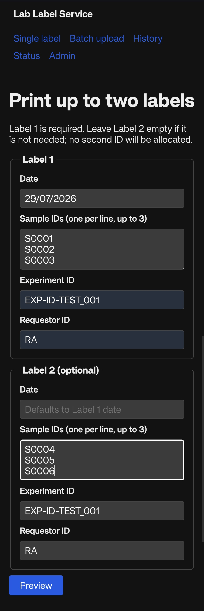
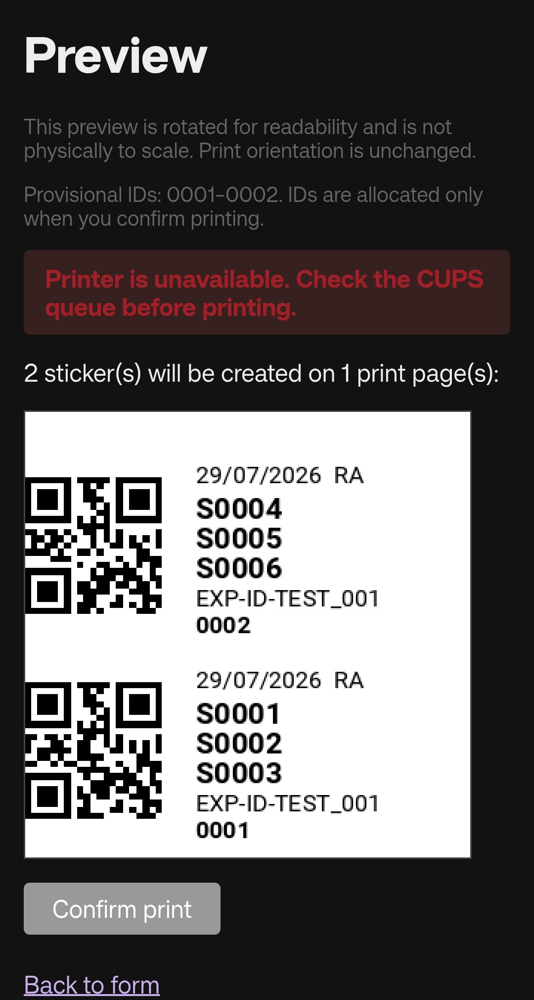
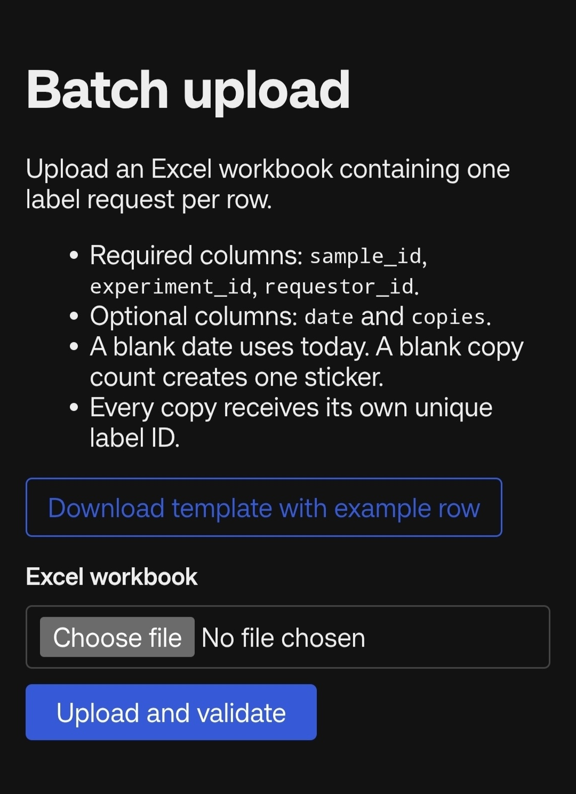
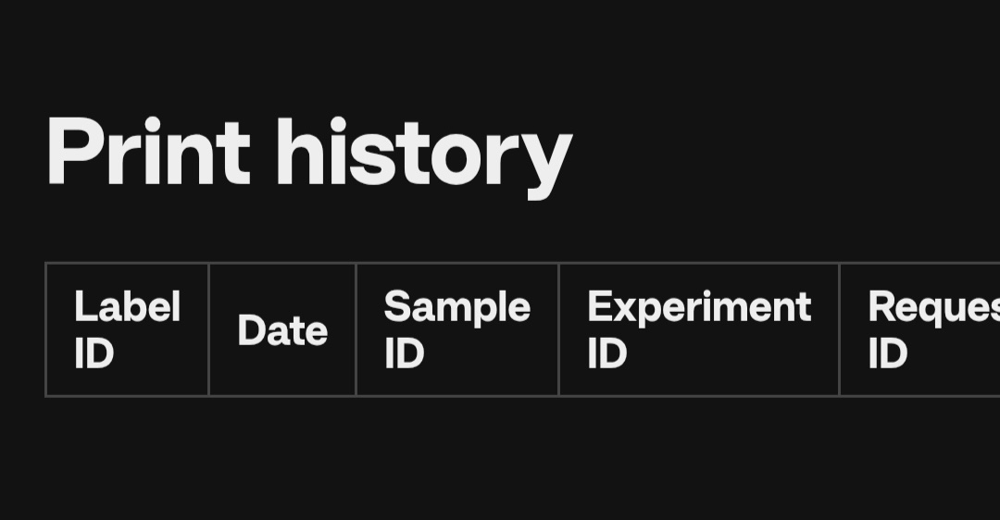
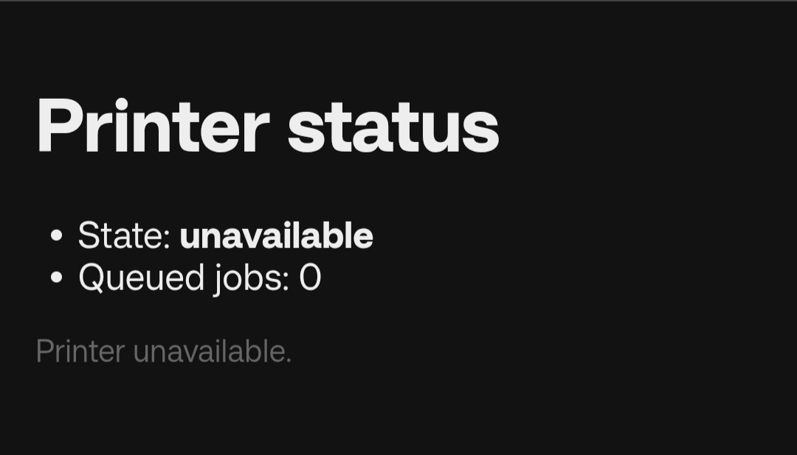
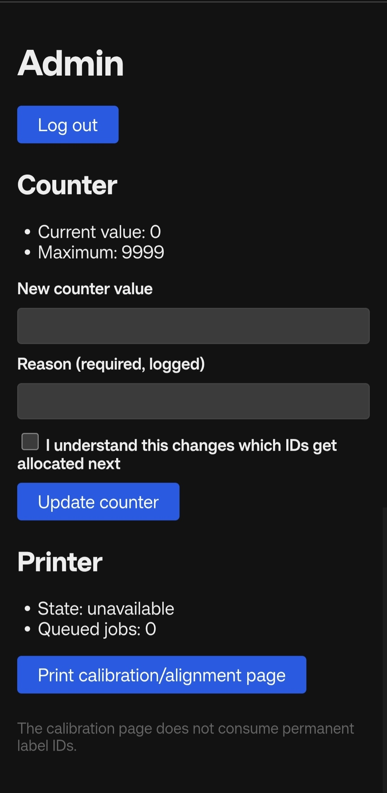

# Lab Label Printer - Basic User Guide

## 1. Connect to the printer

Connect your phone, tablet or computer to the following Wi-Fi network:

```text
Network: Lab Label Printer
```

Enter the Wi-Fi password when prompted. This network is local to the label printer and does not provide internet access.

Open a web browser and go to:

```text
http://10.42.0.1:8000
```

## 2. Sign in

Enter the shared lab password and select **Sign in**.

Once signed in, the navigation menu provides access to:

- **Single label**
- **Batch upload**
- **History**
- **Status**
- **Admin**

## 3. Print one or two labels

Select **Single label**.

The printer’s label stock contains two sticker positions, so the form allows up to two different labels to be prepared together.

### Label 1

Complete the following fields:

- **Date** - defaults to today.
- **Sample IDs** - enter one to three identifiers, one per line. These are
  shown prominently on the label.
- **Experiment ID**
- **Requestor ID**

Label 1 is required.

### Label 2

Complete Label 2 if you need a second label. Its Experiment ID and Requestor ID initially follow those entered for Label 1, but they can be changed independently.

Leave Label 2 empty if it is not required. The second sticker position will remain blank and no ID will be allocated to it.

{ width=42% }

Select **Preview**.

## 4. Check the preview

The preview shows how the labels will appear. It is rotated on screen to make the text easier to read; this does not alter the physical print orientation.

Check the following carefully:

- Sample ID
- Experiment ID
- Requestor ID
- Date
- Number of stickers

The displayed label IDs are provisional. They are only permanently allocated when printing is confirmed.

If anything is incorrect, select **Back to form** and make the necessary changes.

If everything is correct, select **Confirm print**.

{ width=42% }

A confirmation page will show the allocated label IDs and the printer job identifier.

## 5. Print a batch from Excel

Select **Batch upload** when preparing several labels.

Download the provided Excel template and enter one label request per row.

Required columns:

- `sample_id` - enter up to three IDs on separate lines within the cell.
- `experiment_id`
- `requestor_id`

Optional columns:

- `date` - a blank date uses today’s date.
- `copies` - a blank value creates one sticker.

Each copy receives its own unique label ID.

{ width=52% }

Save the completed workbook as an `.xlsx` file. On the Batch upload page:

1. Select the workbook.
2. Select **Upload and validate**.
3. Review the rows, sticker count and provisional ID range.
4. Select **Confirm print** when everything is correct.

If the batch contains an odd number of stickers, the unused position on the final page will remain blank and will not consume an ID.

## 6. View previous labels

Select **History** to view labels that have already been submitted.

The history table shows:

- Label ID
- Date
- Sample ID
- Experiment ID
- Requestor ID
- Source
- Status
- Creation time

For labels created from an Excel batch, the original uploaded workbook can be downloaded from the history.

Select a label ID to open its detailed record.

{ width=72% }

## 7. Reprint a label

Open the required label from **History**.

Optionally enter a reason for the reprint, then select:

**Reprint this label**

A reprint preserves the original label ID. It does not allocate a new ID.

Check that you have selected the correct historical record before submitting the reprint.

## 8. Check printer status

Select **Status** to see whether the printer is ready and whether any jobs are waiting in the queue.

Possible states include:

- **Ready** - the printer is available.
- **Paused** - the print queue has been paused.
- **Unavailable** - the printer cannot currently be reached.
- **Pending/unknown** - a job may still be processing.

{ width=65% }

## 9. Admin functions

The **Admin** page contains maintenance controls, including:

- Viewing the current label ID counter.
- Printing a calibration/alignment page.
- Logging out.

Changing the ID counter affects all subsequently allocated label IDs and should only be done by an administrator. A reason must be entered and the change is logged.

The calibration page does not consume a permanent label ID.

{ width=42% }

## Troubleshooting

### The web page does not open

Confirm that the device is connected to **Lab Label Printer**, then enter the complete address:

```text
http://10.42.0.1:8000
```

The printer network has no internet access. A device may therefore warn that the network has “no internet”; remain connected to it.

### The print button is disabled

Check the error shown above the preview. The printer may be unavailable or its queue may be paused.

### A print has not appeared immediately

Check **Status** for queued jobs. Allow a short time for the Pi Zero and printer to process the job before submitting it again.

### Information is incorrect

Return to the form before confirming the print. Once printing has been confirmed, the label ID is permanently recorded.

### The label is damaged or lost

Use **History** to find and reprint the original label. This retains the same ID and avoids creating a duplicate record.
